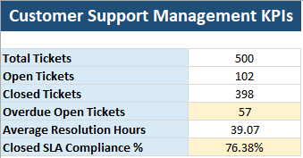
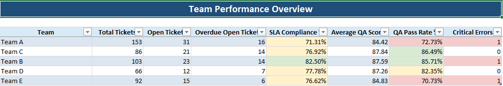
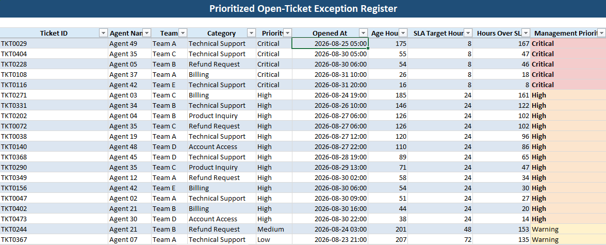

# Customer Support Analytics Automation

Support and operations leads often keep ticket, agent, and quality records in separate files. A total ticket count does not show which open cases are past their response target, or which team needs a closer look. This demo loads sample records and rebuilds an Excel workbook, a prioritized open-case list, and a short management briefing from those records.

## What you'd get

- Sample CSV files for agents, tickets, and QA evaluations in [`data/raw`](data/raw).
- A PostgreSQL schema and the SQL for overall KPIs, team comparison, and the open-ticket register in [`sql/`](sql).
- Python scripts in [`src/`](src) that load the CSVs, write the Excel workbook, write the briefing, and write a prompt for a separate human-reviewed rewrite. `src/generate_report.py` only prints the overall KPIs in the terminal.
- A saved Excel workbook with KPI Summary, Team Performance, and Exception Register sheets: [reports/customer_support_management_report.xlsx](reports/customer_support_management_report.xlsx).
- A saved management briefing: [reports/management_briefing.txt](reports/management_briefing.txt).
- A prompt that asks an assistant to rewrite that briefing without changing the figures: [reports/verified_ai_prompt.txt](reports/verified_ai_prompt.txt).
- Screenshots of those three report views in [`screenshots/`](screenshots).

All data in this repo is synthetic demo/sample data, not client work.

## Business Problem

Support managers need one view of ticket workload, response obligations, and quality results. A total ticket count does not show which overdue cases need review first, or which teams need a closer look.

## Solution

```text
Synthetic CSV data -> PostgreSQL tables and integrity constraints
-> SQL KPI and team analysis -> prioritized open-ticket register
-> Excel report and management briefing written by the scripts
-> optional human-reviewed AI rewrite
```

The workflow points to urgent open cases, compares SLA and QA results, and shows which teams the sample data flags. A person runs the scripts. This repository does not connect to a live helpdesk.

## Data

The included [source files](data/raw) contain **50 agents, 500 tickets, and 238 QA evaluations**, all synthetic. Ticket aging uses the generator's fixed snapshot of **1 September 2026, 12:00**, not the current date.

The [schema](sql/schema.sql) defines primary keys, foreign keys, typed fields, and required values. The [loader](src/load_database.py) converts CSV values and prints loaded row counts. SLA flags and age values are prepared by the data generator. This is a demonstration pipeline, not a connection to a live ticketing system.

## Analysis

- Open and closed workload, overdue open tickets, and average closed-ticket resolution time.
- **Closed-ticket SLA compliance:** closed tickets within SLA divided by all closed tickets.
- Team-level SLA compliance, average QA score, QA pass rate, and critical errors. Ticket and QA metrics are aggregated separately before joining by team.
- The open-ticket register includes every open ticket. Sort order is Critical overdue, then High-priority overdue, then other breached cases at least 168 hours over SLA, then other breached cases, then On Track. In the register, the 168-hour group is labeled High, other breached cases are labeled Warning, and the remaining open cases are labeled On Track.

## Decision Support

The saved [briefing](reports/management_briefing.txt) calls out five Critical overdue cases, Team A's overdue backlog and SLA result, and Team E's QA pass rate. Those points are reasons to review escalation, workload, and coaching questions. They do not establish why the sample results look that way.

## Automated Action

Python scripts load the database, query reporting metrics, format the Excel workbook, produce the briefing, and prepare a [grounded AI prompt](reports/verified_ai_prompt.txt). A person runs the scripts in sequence. The optional rewrite is done separately in an AI assistant and reviewed by a person. No AI API call, ticket reassignment, outbound notification, or scheduled run is implemented here.

## Measured / Demonstrated Outcome

The committed CSVs, Excel report, and briefing agree on this synthetic snapshot. These are sample-data figures, not measured client results.

| Measure | Result |
|---|---:|
| Total tickets | 500 |
| Open / closed tickets | 102 / 398 |
| Overdue open tickets | 57 |
| Closed-ticket SLA compliance | 76.38% |
| Average closed-ticket resolution | 39.07 hours |
| Critical-priority overdue open tickets | 5 |

Team A has 16 overdue open cases and 71.31% closed-ticket SLA compliance. Team E has a 70.73% QA pass rate. The workflow can produce the same metrics again from this sample. Outcomes of any follow-up action have not been measured.

## Screenshots / Outputs

The [Excel workbook](reports/customer_support_management_report.xlsx) contains KPI Summary, Team Performance, and Exception Register sheets.







## Tools

Python, PostgreSQL, SQL, psycopg, openpyxl, and Excel. The optional AI stage is a text prompt for a human-reviewed rewrite.

## How to Run

Download or clone this repository. Use a **dedicated local demonstration database**: the schema drops the three project tables, and the loader clears their contents before reloading.

1. Install Python and PostgreSQL. From the repository root, create a virtual environment and install the script dependencies:

   ```bash
   python -m venv .venv
   # Windows PowerShell: .\.venv\Scripts\Activate.ps1
   # macOS/Linux: source .venv/bin/activate
   python -m pip install "psycopg[binary]" openpyxl
   ```

2. Create the database and apply its schema using PostgreSQL's command-line tools (or run the equivalent steps in pgAdmin):

   ```bash
   createdb -h localhost -p 5432 -U postgres customer_support_analytics
   psql -h localhost -p 5432 -U postgres -d customer_support_analytics -f sql/schema.sql
   ```

3. Use the committed CSVs to reproduce the saved sample, then run:

   ```bash
   python src/load_database.py
   python src/generate_excel_report.py
   python src/generate_briefing.py
   python src/generate_ai_prompt.py
   ```

`src/load_database.py`, `src/generate_excel_report.py`, and `src/generate_briefing.py` prompt for the PostgreSQL password. The host, port, user, and database name are written in those files: `localhost`, port `5432`, user `postgres`, and database `customer_support_analytics`. If your local PostgreSQL settings differ, change those values in the three scripts. `src/generate_ai_prompt.py` reads `reports/management_briefing.txt` and does not connect to the database. `src/generate_report.py` uses the same connection settings and only prints the overall KPIs. It is not required for the Excel report or the briefing.

Close the existing Excel report before overwriting it. Outputs are written to `reports/`.

The optional [data generators](src) create agents, tickets, and QA records in that order: `generate_data.py`, `generate_tickets.py`, `generate_qa.py`. They overwrite the sample CSVs. The reporting steps above do not require regenerating data.

[Portfolio overview](https://github.com/23-06109#selected-projects)

## Work with me

I offer a fixed-price, async Operations Reporting Automation Sprint: you send a messy Excel/CSV tracker, I send back a clean report that rebuilds on refresh, an overdue action list and a short how-to video. No meetings. Message me on LinkedIn: https://www.linkedin.com/in/jimmyjrmanalon/
